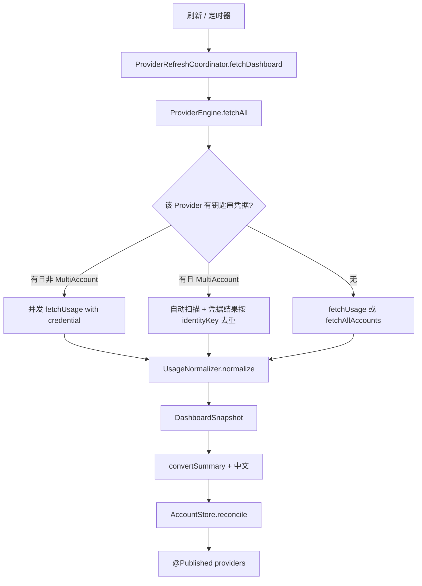

# 模型余量监控：设计与实现

本文整理 AIUsage 里 **官方订阅剩余额度** 的设计与落地，供其他项目对照复用。

本地费用账本（`claude` / `codex-cost` / `opencode`）只在需要对比时提及。它们读的是本机代理归档 / session JSONL / OpenCode DB，不是厂商订阅余量接口。本地账本细节见 [USAGE_AND_BILLING.md](./USAGE_AND_BILLING.md)。

阅读对象：要在另一套代码里做「粘贴 Key / 读本地登录态 → 拉官方额度 → 统一成卡片」的同学。不必先熟悉 Swift。

---

## 1. 要解决什么问题

各家 Coding Plan / Token Plan / CLI 订阅的接口、鉴权、窗口语义都不一样：

| 维度 | 差异 |
|------|------|
| 鉴权 | 裸 API Key、`Bearer` Key、OAuth `auth.json`、浏览器 Cookie、`gh` token |
| 区域 | 国内 / 海外两套域名，Key 通常不能混用 |
| 窗口 | 5 小时滚动 + 周限（GLM / MiniMax / Kimi / Codex）；或按模型族 / 通道拆条 |
| 百分比方向 | 有的字段是 **已用 %**，有的是 **剩余 %** |
| 失败形态 | HTTP 401、业务码、空数组（按量付费 Key 查不到订阅额度） |

AIUsage 把这些差异压进三层：

1. **Provider**：只负责「用凭据打官方接口，吐出原始窗口」。
2. **Normalizer**：把原始窗口收成统一卡片语义（剩余 %、状态、文案）。
3. **App / UI**：刷新调度、账号注册表、卡片 / 详情 / 菜单栏。

其他项目最小可复用的是第 1、2 层。UI 可以换成任意前端。

---

## 2. 模块边界

```
AIUsage/                          SwiftUI App
  Models/                         目录、账号注册表、UI 数据模型
  Services/                       连接流程、Keychain 账号表
  ViewModels/                     刷新调度、Summary → UI 转换
  Views/                          选择器、连接页、卡片、详情、菜单栏

QuotaBackend/                     SwiftPM 包（可单独测、可被 HTTP 服务复用）
  ProviderProtocol.swift          协议与原始数据类型
  Engine/                         Registry、并发抓取、凭据仓库
  Providers/                      各厂商 fetcher
  Normalizer/                     ProviderUsage → ProviderSummary
```

App 通过本地 SPM 引用 QuotaBackend（`import QuotaBackend`）。可选的 `QuotaServer` 把同一套 `ProviderEngine` 暴露成 `GET /api/dashboard`，App 可切 `backendMode = remote`。

核心对象关系：

```
AppState
  ├── ProviderRefreshCoordinator     刷新引擎、@Published 卡片数据
  ├── AccountStore                   账号注册表
  └── AppSettings                    刷新间隔、local/remote

ProviderRefreshCoordinator
  └── ProviderEngine (actor)         并发 fetch + normalize

AccountCredentialStore (Keychain)    API Key / token / auth 文件路径
SecureAccountVault                   账号元数据（折叠进同一条 Keychain）
```

---

## 3. 核心数据模型

文件：`QuotaBackend/Sources/QuotaBackend/ProviderProtocol.swift`  
归一化结果：`QuotaBackend/Sources/QuotaBackend/Normalizer/ProviderSummary.swift`

### 3.1 协议

```text
ProviderFetcher
  id / displayName / description
  fetchUsage() -> ProviderUsage          // 无凭据：扫本地登录态，或抛 not_logged_in

CredentialAcceptingProvider : ProviderFetcher
  supportedAuthMethods
  fetchUsage(with: AccountCredential)    // 用钥匙串里的凭据拉额度

MultiAccountProviderFetcher : ProviderFetcher
  fetchAllAccounts() -> [AccountFetchResult]   // Codex / Antigravity 等多账号
```

API Key 类（GLM / MiniMax / Kimi）走 `CredentialAcceptingProvider`。  
OAuth 多账号类（Codex）同时实现后两个协议：自动扫描 + 已托管凭据，再按身份去重。

### 3.2 凭据

```text
AccountCredential
  id, providerId, accountLabel?
  authMethod          cookie | token | authFile | apiKey | oauth | webSession | auto
  credential          密钥明文 / token / auth 文件路径
  metadata            apiRegion、sourcePath、sessionFingerprint …
  createdAt, lastUsedAt
```

`metadata["apiRegion"]` 取值：`auto` / `china` / `international`。缺省按 `auto`。

### 3.3 原始用量 `ProviderUsage`

Provider 只填自己确定知道的字段，不臆造邮箱或套餐名。

| 字段 | 含义 |
|------|------|
| `provider` | 稳定 id，如 `glm` |
| `usageAccountId` | 账号稳定键：邮箱 > 官方 user id > `provider-{keyFingerprint}` |
| `accountEmail` / `accountPlan` | 接口有才填 |
| `primary` / `secondary` / `tertiary` | 最多三档窗口 |
| `extra` | 窗口标签、解析到的区域、模型权益等 |
| `source` | `manual-api-key` / `kimi-config` / `gh-cli` … |

### 3.4 原始窗口 `RawQuotaWindow`

| 字段 | 含义 |
|------|------|
| `usedPercent` | 已用百分比 |
| `remainingPercent` | 剩余百分比（卡片和告警主要用这个） |
| `resetAt` | ISO 8601 |
| `entitlement` / `remaining` | 绝对值（有则填，便于详情展示） |
| `unlimited` | 无限通道（Copilot 部分 lane） |
| `label` | Provider 内部标签，通常改放到 `extra["primaryLabel"]` |

**双窗口约定（GLM / MiniMax / Kimi / Codex）：**

- `primary` = 更短的滚动窗（约 5 小时）
- `secondary` = 周限
- `tertiary` = 第三条限制（Kimi 额外频控、Codex Code Review）

卡片首行永远是 5 小时，不要按「哪个更紧」重排窗口顺序。告警另取最紧窗口，见 §7。

### 3.5 归一化结果 `ProviderSummary`

这是 UI 真正消费的形状（App 再转成 `ProviderData`）。

| 字段 | 含义 |
|------|------|
| `id` | `{providerId}:{usageAccountId}` |
| `category` | 官方余量写 `"quota"`；本地账本写 `"local-cost"` |
| `remainingPercent` | **所有窗口里最小的剩余 %**，驱动 healthy / watch / critical |
| `windows[]` | 卡片多行 |
| `status` | `healthy` / `watch` / `critical` / `error` … |
| `errorCode` | 仅失败态：`not_logged_in`、`invalid_credentials`、`empty_usage` … |
| `headline` / `metrics` / `spotlight` | 详情页文案 |
| `raw` | 保留原始 `ProviderUsage` |

状态阈值（`UsageNormalizer.resolveStatus`）：

- 剩余 > 30% → `healthy`
- ≤ 30% → `watch`
- ≤ 12% → `critical`
- 没有剩余 % → `healthy` + `Active`（已连通但无法量化）

### 3.6 抓取结果 `ProviderResult`

```text
id                auto:{provider}:{account} 或 cred:{provider}:{credentialId}
ok                是否成功
summary           成功时的 ProviderSummary
error             人类可读错误
errorCode 在 summary 上
```

---

## 4. 一次刷新怎么走

本地模式（默认）：



```text
用户点刷新 / 定时器
  → AppState.refreshAllProviders()
  → ProviderRefreshCoordinator.fetchDashboard()
  → 可选：同步尚未托管的本地登录态
  → ProviderEngine.fetchAll(ids: 已勾选的 provider)
       每个 Provider 一个 Task（并发）
       对每个账号：
         有钥匙串凭据且非 MultiAccount → fetchUsage(with:)
         有钥匙串凭据且 MultiAccount   → 自动扫描 + 凭据结果 merge
         否则                         → fetchUsage()   // 常抛 not_logged_in
         成功 → UsageNormalizer.normalize(...)
         失败 → errorSummary(code, message)
  → DashboardSnapshot
  → convertSummary + 中文本地化
  → AccountStore.reconcileAccountRegistry
  → @Published providers 更新，SwiftUI 重绘
```

远程模式：App 调 `GET /api/dashboard?ids=...`，QuotaServer 内部仍走 `ProviderEngine`。

超时（`ProviderEngine`）：

| Provider | 超时 |
|----------|------|
| 默认 | 15s |
| Codex | fetch 侧 20s（Provider 自己的 timeout） |
| Droid | 45s（多域名探测） |
| OpenCode 本地账本 | 60s |
| Codex 本地账本 | 300s |

`fetchAll` 按 Registry 顺序分组排序，保证仪表盘稳定。

多账号合并规则（Codex 等）：自动扫描结果与凭据结果按 `identityKey` 去重；凭据成功则丢掉同身份的泛化 auto 错误，避免一张卡变两张。

---

## 5. 凭据怎么存、怎么连

### 5.1 存储

`AccountCredentialStore` 把全部 `AccountCredential` 放进 **一条** Keychain 项：

- service：正式版 `com.aiusage.desktop.providerCredentials`（Debug / 测试用独立 service）
- account：`__credential_vault_v2__`
- 账号注册表等辅助 blob 叠在同一条目，减少「始终允许」弹窗

刷新成功会更新 `lastUsedAt`，**不会**每次重写 Key。连接成功时会把解析到的 `apiRegion` 写回 metadata，下次直打对应端点。

### 5.2 手动 API Key 连接（GLM / MiniMax / Kimi）

```text
连接页：区域分段（auto / china / international）+ SecureField
  → ProviderAuthManager.authenticateManualCredential(...)
       metadata.sourceIdentifier = manual:{authMethod}:{uuid}
       metadata.importedAt / identityScope
       仅当用户没选 auto 时才预写 metadata.apiRegion
       provider.fetchUsage(with:) 真打接口
       成功则用 usage.extra["apiRegion"] 覆盖 metadata（锁定命中端点）
  → AppState.registerAuthenticatedCredential
       再从 usage 补 accountHandle / accountId / accountPlan / apiRegion
       同账号已有凭据则复用旧 credential.id，合并 metadata
       写入 Keychain + 账号注册表
  → 立刻 insertImmediateProviderData
  → 清掉同 provider 的 needsCredentialConnection 占位行
  → 勾选该 provider（ensureProviderSelected）
  → fetchSingleProvider 再拉一遍
```

`auto` 探测顺序与各 Provider 的 `usageEndpoints` 数组一致：**国内在前、海外在后**。连接页文案也写「先试国内」。

Kimi 额外会扫 `~/.kimi/config.toml` 的 `api_key`，无托管凭据时 `fetchUsage()` 也能工作。

### 5.3 区域 `ProviderAPIRegion`

文件：`QuotaBackend/Sources/QuotaBackend/Providers/ProviderAPIRegion.swift`

```text
auto            按传入顺序试全部端点；鉴权失败换下一个
china           只打国内端点，禁止跨区回退
international   只打海外端点，禁止跨区回退
```

`orderedEndpoints(chinaContains:internationalContains:)` 用 URL 子串把对应端点排到前面。

**不要**在用户明确选了国内时去试海外：混区 Key 会得到难以理解的 401。

---

## 6. Provider 一览

官方订阅（`kind: .official`，`category: quota`）：

| id | 名称 | 鉴权 | 窗口形态 |
|----|------|------|----------|
| `glm` | GLM Coding Plan | 粘贴 Coding Plan Key | 5h + 周 |
| `minimax` | MiniMax Token Plan | 粘贴 `sk-cp-…` | 5h + 周 |
| `kimi` | Kimi Code | 粘贴 `sk-…` 或 `~/.kimi` | 5h 频控 + 周 |
| `codex` | Codex | `~/.codex/auth.json` / token | 5h + 周 + Code Review |
| `copilot` | Copilot | `gh auth token` / 手动 token | 多 lane |
| `cursor` | Cursor | 浏览器 Cookie / 粘贴 | 百分比 + 美元额度 |
| `gemini` | Gemini CLI | `~/.gemini/oauth_creds.json` | 按模型族 |
| `antigravity` | Antigravity | Google OAuth 文件 | 按模型 |
| `kiro` | Kiro | AWS SSO | 请求通道 |
| `warp` | Warp | 本机 App 缓存 | 请求余额 |
| `droid` | Droid | Factory `fk-…` | token 池 |

目录定义在 `AIUsage/Models/AppState.swift` 的 `providerCatalogItems`。  
运行时实例在 `QuotaBackend/.../Engine/ProviderRegistry.swift`。  
**两边都要登记**，漏一边会出现「目录能选、刷新找不到 fetcher」。

下面三节是最适合其他项目抄的 API Key + 双窗口实现。三家对照：

| | GLM | MiniMax | Kimi |
|--|-----|---------|------|
| Provider id | `glm` | `minimax` | `kimi` |
| 鉴权头 | **裸 Key**（剥掉 `Bearer`） | `Bearer sk-cp-…` | `Bearer sk-…` 或 OAuth |
| 国内端点 | `open.bigmodel.cn/api/monitor/usage/quota/limit` | `api.minimaxi.com/v1/token_plan/remains` | `api.kimi.com/coding/v1/usages` |
| 海外端点 | `api.z.ai/api/monitor/usage/quota/limit` | `api.minimax.io/v1/token_plan/remains` | `api.moonshot.ai/v1/usages` |
| 百分比方向 | `percentage` = **已用** | `*_remaining_percent` = **剩余** | `used / limit` 自己算 |
| 窗口分类 | `unit` 3/6 | 字段前缀 `current_interval_*` / `current_weekly_*` | `limits[]` 按时长升序 + `usage` 周限 |
| 鉴权失败信号 | HTTP 401/403 **或** JSON `code` 401/403 **或** `success:false` + unauthorized | `base_resp.status_code` **2049 / 1004**（HTTP 仍常是 200） | HTTP 401/403 |
| 无本地发现 | 无 Key 即 `not_logged_in` | 同左 | 可扫 `~/.kimi/config.toml` |
| 账号 id | `glm-{FNV-1a}` | `minimax-{FNV-1a}` | 官方 id / 邮箱 / `kimi-{FNV-1a}` |
| 只有周限时 | 周限升为 `primary`，标签改成 Weekly | 同左 | 同左 |

**不要**把 GLM 的「鉴权失败」判断抄到 MiniMax：MiniMax 跨区 Key 经常 HTTP 200 + 业务码。反过来也不要把 MiniMax 的 `*_remaining_percent` 当成 GLM 的 `percentage`。

---

## 7. GLM Coding Plan（重点参考）

实现：`QuotaBackend/Sources/QuotaBackend/Providers/GLMProvider.swift`  
解析：同文件 `GLMCodingPlanQuotaParser`  
归一化：`Normalizer/UsageNormalizer+GLM.swift`  
测试：`QuotaBackend/Tests/QuotaBackendTests/GLMProviderTests.swift`  
请求形状对齐 cc-switch `src-tauri/src/services/coding_plan.rs::query_zhipu`。

### 7.1 请求

| 区域 | URL |
|------|-----|
| 国内 | `GET https://open.bigmodel.cn/api/monitor/usage/quota/limit` |
| 海外 | `GET https://api.z.ai/api/monitor/usage/quota/limit` |

```http
Authorization: <Coding Plan API Key>     ← 不要加 Bearer
Accept: application/json
Content-Type: application/json
Accept-Language: en-US,en
User-Agent: AIUsage-GLMMonitor/1.0
```

用户若粘贴了 `Bearer xxx`，先去掉前缀再发（`authorizationHeaderValue`）。

cc-switch 按用户已配置的 coding `base_url` 定点请求、不做跨站回退。AIUsage 没有这份 base_url，所以用区域选择器 + `auto` 回退。

团队套餐（`?type=2` + `bigmodel-organization` / `bigmodel-project`）响应同形，**本仓库首版不做**。

### 7.2 响应

```json
{
  "code": 200,
  "success": true,
  "data": {
    "level": "lite",
    "limits": [
      {
        "type": "CREDIT_LIMIT",
        "unit": 3,
        "number": 5,
        "usage": 2000,
        "currentValue": 71,
        "remaining": 1929,
        "percentage": 3,
        "nextResetTime": 1786073946574
      },
      {
        "type": "CREDIT_LIMIT",
        "unit": 6,
        "number": 1,
        "usage": 10000,
        "currentValue": 71,
        "remaining": 9929,
        "percentage": 1,
        "nextResetTime": 1786660486998
      }
    ]
  }
}
```

`data` 有时是对象（带 `limits` + `level`），有时社区反馈过直接是数组。Parser 两种都收。

| 字段 | 含义 |
|------|------|
| `type` | 只认 `TOKENS_LIMIT` / `CREDIT_LIMIT`（大小写不敏感）。**丢掉 `TIME_LIMIT`**（搜索类额度） |
| `unit` | **3 = 5 小时**；**6 = 周**。不要绑 `number`（周窗出现过 `number: 1` 和 `7`） |
| `usage` | 窗口上限 |
| `currentValue` | 已消耗 |
| `remaining` | 剩余绝对值 |
| `percentage` | **已用百分比**（不是剩余） |
| `nextResetTime` | Unix **毫秒** |
| `level` | `lite` / `pro` / `max` → 展示 Lite / Pro / Max |

旧套餐（约 2026-02-12 前）可能只回 1 条 `TOKENS_LIMIT`，只展示 5 小时窗。  
新套餐回 2 条。V3 用 `CREDIT_LIMIT`，字段同形。

### 7.3 窗口分类（必须按这个优先级）

1. 有 `unit` 3 / 6：直接入 5h / 周槽。同一槽已被占的条目降级进未分类。
2. `unit` 缺失或不认识：未分类。
3. 未分类排序：**没有 `nextResetTime` 的优先当 5h**（0% 时 5h 桶可能不带 reset），其余按 reset 升序。
4. 依次填空槽：先 5h，再周。最多两条，第三条丢掉。

**禁止**只按 `nextResetTime` 排序当窗口类型。周期末尾周限可能比 5 小时更早重置（cc-switch issue #3036），时间排序会标反。

### 7.4 百分比怎么算

- 有 `usage` + `currentValue`：`usedPercent = currentValue / usage * 100`，`remainingPercent = 100 - usedPercent`。更精确。
- 否则用 `percentage` 当已用 %（cc-switch 主路径；无效 / 缺失当 0）。
- 不要把 `percentage` 当成剩余 %。MiniMax 的 `*_remaining_percent` 才是剩余。

### 7.5 失败

| 情况 | 处理 |
|------|------|
| HTTP 401 / 403 | 鉴权失败；`auto` 换另一区域 |
| JSON `code` 401 / 403，或 `success:false` 且文案含 unauthorized / invalid api | 同上 |
| 普通业务错误（`success:false` + 其他文案） | `api_error`，**不要**当成鉴权失败去换区 |
| `limits` 空，或只剩 `TIME_LIMIT` | `empty_usage`：按量付费 Key 或非 Coding Plan Key |
| 显式区域且该端点拒 Key | 提示检查 Key 或改区域 |

只有周限、没有 5h 时：周限升为 `primary`，`primaryLabel = "Weekly Window"`，不造空的 5h 行。

账号 id：`glm-{FNV-1a(apiKey)}`（`KimiProvider.stableFingerprint`）。算法见 §14.1。

品牌图标：cc-switch 用 `zhipu` 星点 SVG，不是字母 G。资源在 `AIUsage/Resources/Assets.xcassets/ProviderIcons/glm.imageset/`。

控制台（连接页「获取 API Key」按区域跳转）：

- 国内：`https://open.bigmodel.cn/usercenter/apikeys`
- 海外：`https://z.ai/manage-apikey`

---

## 8. MiniMax Token Plan

实现：`QuotaBackend/Sources/QuotaBackend/Providers/MiniMaxProvider.swift`  
归一化：`Normalizer/UsageNormalizer+MiniMax.swift`

| 区域 | URL |
|------|-----|
| 国内 | `GET https://api.minimaxi.com/v1/token_plan/remains` |
| 海外 | `GET https://api.minimax.io/v1/token_plan/remains` |

```http
Authorization: Bearer <sk-cp-…>
Accept: application/json
```

只认订阅 Key（`sk-cp-`）。普通按量 `sk-` 查不了这个接口。

响应要点：

```text
model_remains[]
  model_name == "general"     ← 主卡片用文本/语言模型，忽略 video 等
  current_interval_*          ← 5 小时滚动
  current_weekly_*            ← 周
  end_time / remains_time     ← 5h 重置（Unix ms / 剩余 ms）
  weekly_end_time / weekly_remains_time
base_resp.status_code == 0    ← 业务成功；HTTP 仍可能是 200
```

百分比字段是 **剩余 %**（`current_interval_remaining_percent`）。但实现里若同时有 `total_count` + `usage_count`，**优先用计数重算** `used/limit`，不再信 percent 字段；只有计数缺失时才用 remaining percent（未激活时常回 99/100 且 count 为 0）。

`resetAt`：优先 `end_time`（Unix **毫秒**），否则 `now + remains_time/1000`。

选条目：优先 `model_name == "general"`，否则第一个非 `video`，再否则数组第一项。

业务码看 `base_resp.status_code`，**不要**只看 HTTP：

| `status_code` | 含义 | 处理 |
|---------------|------|------|
| `0` | 成功 | 继续 parse |
| `2049` / `1004` | Key 无效或区域不对（文案可能是 invalid api key / cookie is missing） | 记鉴权失败，`auto` 换端点 |
| 其它非 0 | 业务错误 | `api_error`，**不要**换区 |

HTTP 非 2xx 在 MiniMax 路径里只记 `http_error` 后试下一个端点，**没有**单独把 401/403 标成鉴权失败。跨区场景主要靠上面两个业务码。

账号 id：`minimax-{FNV-1a(apiKey)}`。

---

## 9. Kimi Code

实现：`QuotaBackend/Sources/QuotaBackend/Providers/KimiProvider.swift`  
归一化：`Normalizer/UsageNormalizer+Kimi.swift`

| 区域 | URL |
|------|-----|
| 国内 | `GET https://api.kimi.com/coding/v1/usages` |
| 海外 | `GET https://api.moonshot.ai/v1/usages` |

```http
Authorization: Bearer <sk-… 或 OAuth token>
```

响应根可以是 `{ data: { usage, limits, email? } }` 或直接带 `usage` / `limits`。

| 字段 | 映射 |
|------|------|
| `limits[]` | 频控窗。按 `window.duration` + `timeUnit` **升序**，最短（约 5h）→ `primary` |
| `usage` | 周 / 总额度 → `secondary` |
| 没有 `limits` 只有 `usage` | 周限升为 `primary` |

文件头注释里写过 `usage → primary`，**实现已改成对齐 Codex**：首行是 5 小时频控。移植时以 `fetchUsage` 实现为准，不要抄文件头。

HTTP 401 / 403 在 `auto` 下换区。本地可发现 `~/.kimi/config.toml` 的 `api_key`（`source.type = kimi-config`）。

`supportedAuthMethods`：`[.apiKey, .auto]`。GLM / MiniMax 只有 `.apiKey`。

---

## 10. 其他官方 Provider（对照用）

这些不是「粘贴 Coding Plan Key」模板，但移植时能对上鉴权类型。

| id | 怎么拿到凭据 | 怎么拉额度 |
|----|--------------|------------|
| `codex` | `~/.codex/auth.json`，过期打 `https://auth.openai.com/oauth/token` | `GET {baseURL}wham/usage`，Bearer access_token。窗口在 `rate_limit.primary_window` / `secondary_window` |
| `copilot` | `gh auth token` 或手动 token | `GET https://api.github.com/copilot_internal/user` + `/user`；多 lane，部分 unlimited |
| `cursor` | Chromium Cookie 库 / Web 登录 / 粘贴 | `cursor.com/api/usage-summary`、`/api/auth/me`、`/api/usage` |
| `gemini` | `~/.gemini/oauth_creds.json` 刷新 | `cloudcode-pa.googleapis.com/v1internal:retrieveUserQuota` |
| `droid` | Factory `fk-…` | 多域名探测 + token 池 |
| `warp` | 本机 Warp 应用缓存 | 不打公网订阅接口 |
| `kiro` | AWS SSO device flow | AWS 侧用量通道 |
| `antigravity` | Google OAuth 文件 | 多 workspace、按模型 |

Codex OAuth client id 与默认 `https://chatgpt.com/backend-api/` 写在 `CodexProvider.swift`。移植时注意 refresh 与多 `auth.json` 去重（见 `docs/CODEX_IDENTITY_CHAIN.md`）。

---

## 11. 归一化怎么写

入口：`UsageNormalizer.normalize(provider:usage:)`  
按 `provider.id` 分发到 `UsageNormalizer+Xxx.swift`。

`base.category` 先写成 `"snapshot"`，各 `normalizeXxx` 再改成 `"quota"` 或 `"local-cost"`。漏改会进默认 snapshot，仪表盘过滤会漏卡。

`channel`（`UsageNormalizer.channel`）：

| channel | provider |
|---------|----------|
| `ide` | cursor, copilot, kiro, antigravity, warp |
| `local` | claude, codex-cost, opencode |
| `cli` | 其余（含 glm / kimi / minimax / codex / gemini / droid） |

双窗口官方套餐的固定配方（GLM / MiniMax / Kimi 几乎一样）：

```text
windows[0] = createPercentWindow(primaryLabel ?? "5h Window", primary)
windows[1] = createPercentWindow(secondaryLabel ?? "Weekly Window", secondary)
remainingPercent = min(各窗口 remainingPercent)
status = resolveStatus(remainingPercent)
category = "quota"
metrics = Plan / Account / 5h Reset / Weekly Reset / Source
headline.primary = 最紧窗口的剩余百分比
```

`createPercentWindow` 用 `remainingPercent` 生成 `"xx% left"`。  
告警看 `remainingPercent`（最紧），展示顺序看 primary/secondary（5h 在前）。这两件事不要绑在一起。

主题色在 `UsageNormalizer.providerThemes`。漏登记会落到灰色默认主题。

---

## 12. App 侧：目录、刷新、UI

### 12.1 目录与勾选

`AppState.providerCatalogItems` 决定「添加来源」里有谁。  
`selectedProviderIds`（UserDefaults）决定刷新哪些。  
`ProviderRefreshCoordinator.selectedProviderIDList()` = 目录顺序 ∩ 勾选。

`kind`：

- `.official` — 本文的官方余量
- `.costTracking` — 本地账本

### 12.2 连接页

`ProviderAccountEditorView`：glm / kimi / minimax 都是「区域分段 + SecureField + 连接」。  
文案来自 `ProviderAuthManager.plan(for:)`。  
OAuth 类走各自 `*LoginCoordinator`。

### 12.3 卡片双窗口

`ProviderCard.multiWindowProviderIds = ["codex", "kimi", "minimax", "glm"]`  
且 `windows.count >= 2` 且至少一行有 `remainingPercent` 时，走 `MultiWindowQuotaView`（最多两行进度）。  
样式：`AppSettings.quotaIndicatorStyle`（bar / ring / segments）。

### 12.4 未连接 vs 真失败

```text
needsCredentialConnection =
  status == error && errorCode ∈ { not_logged_in, missing_token }
```

`invalid_credentials` / `empty_usage` 当真实错误，引导换 Key，不要只显示「去连接」。  
首次加载未完成时不要闪「凭证过期」（`hasCompletedInitialLoad`）。

### 12.5 中文

动态英文（Plan 名、spotlight、窗口名）在 `ProviderRefreshCoordinator+Conversion.swift` 的 `exactTranslations` 里映射。新文案不登记，中文界面会原样显示英文。

---

## 13. 错误码约定

`ProviderError(code, message)`。UI 认 code，message 给人看。

| code | 何时用 |
|------|--------|
| `not_logged_in` | 没有凭据，也扫不到本地登录 |
| `missing_token` / `missing_credential` | 凭据空 |
| `unsupported_auth_method` | 例如 GLM 只收 apiKey |
| `invalid_credentials` | 鉴权失败（两区都拒，或显式区域拒） |
| `empty_usage` | 接口通了但没有可用订阅窗口（按量 Key） |
| `http_error` | 非 2xx 且不是鉴权 |
| `api_error` | 业务 `success:false` 等 |
| `parse_failed` | JSON 坏了 |
| `timeout` | 引擎超时 |

区域回退伪代码（骨架相同，**鉴权失败判定各家不同**）：

```text
endpoints = region.orderedEndpoints(全部端点, chinaContains, internationalContains)
candidates = region.allowsCrossRegionFallback ? endpoints : endpoints.prefix(1)

for url in candidates:
    发请求
    若 isAuthFailure(响应) → sawAuth = true; continue
    若能 parse 出至少一条窗口 → 记下 resolvedRegion，返回
    否则 lastError = 业务/解析错误

if sawAuth → invalid_credentials（按区域给文案）
else → lastError ?? unknown_error
```

`isAuthFailure`：

- **GLM**：HTTP 401/403，或 JSON `code` 401/403，或 `success == false` 且文案含 `unauthorized` / `invalid api`。普通 `success:false` 是 `api_error`，不换区。
- **MiniMax**：`base_resp.status_code ∈ {2049, 1004}`。HTTP 非 2xx 只当 `http_error`。
- **Kimi**：HTTP 401/403。

`orderedEndpoints` 只是把偏好端点排到前面；真正禁止跨区的是 `allowsCrossRegionFallback` + `prefix(1)`。

---

## 14. 在其他项目里怎么复用

不必搬 SwiftUI。建议按这个顺序抄：

### 14.1 建议直接带走的工具函数

**数字宽松解析**（`KimiProvider.num`）：JSON 里同一字段可能是 Int / Double / NSNumber / 数字字符串。统一收成 `Double?`，再 `Int(rounded())` 写绝对值。不要假设全是 Int。

**多 key 取字符串**（`KimiProvider.firstString(dict, keys)`）：按候选 key 顺序取第一个非空字符串。GLM 的 `msg`/`message`、`level`/`plan`/`tier` 都走这条。

**Key 指纹**（`KimiProvider.stableFingerprint`，64-bit FNV-1a 截成 8 位 hex）：

```text
hash = 1469598103934665603          // FNV offset basis
for each utf8 byte:
    hash ^= byte
    hash *= 1099511628211           // FNV prime（溢出按 UInt64 wrap）
return printf("%08x", UInt32(truncatingIfNeeded: hash))
```

换 Key = 新账号卡。不要用邮箱哈希冒充（接口经常不给邮箱）。

**JSON 值盒子**：`extra` 用只含 Bool/Int/Double/String/嵌套字典数组的包装类型（本仓库 `AnyCodable`），才能 Codable + 跨 actor。

### 最小闭环（一个 Coding Plan）

1. 定义 `RawQuotaWindow` / `ProviderUsage` / `ProviderError`（或你们自己的等价物）。
2. 实现一个 fetcher：区域列表 + 鉴权头 + 解析 + 填 primary/secondary。
3. 把 `remainingPercent` 收成卡片：两行窗口 + 最紧窗口告警。
4. 凭据放系统钥匙串 / 加密存储，刷新只读不重写。
5. 连接时真打一次接口，把命中的区域写回。

### 抄哪一家当模板

| 目标厂商 | 抄谁 |
|----------|------|
| 国内/海外两域名 + 粘贴 Key + 5h/周 | MiniMax（Bearer）或 GLM（**裸 Key**） |
| 有本地 CLI 配置可发现 | Kimi |
| OAuth 文件 + 多账号 | Codex |
| Cookie / 浏览器会话 | Cursor |

### 新增一家官方余量（本仓库清单）

1. `QuotaBackend/Providers/XxxProvider.swift`：`fetchUsage()` 无 Key 抛 `not_logged_in`；`fetchUsage(with:)` 打官方接口。
2. `UsageNormalizer+Xxx.swift` + `switch` case + `providerThemes`。
3. `ProviderRegistry.all` 追加。
4. `AppState.providerCatalogItems` 追加，`kind: .official`。
5. `ProviderAuthManager.plan(for:)`。
6. 连接 UI：Key 用 glm/minimax 段落；能扫本地则写 `discoverCandidates`。
7. 图标资源（`ProviderIcons/xxx.imageset`）+ 品牌色。
8. 双窗口则加入 `multiWindowProviderIds`。
9. `exactTranslations` 中文。
10. Parser 单测 + `ProviderRegistryTests`。

QuotaBackend 是 SPM，新 `.swift` 会进 target，一般不用改 `pbxproj`。App 图标在 xcassets 即可。

### 移植时不要省的测试

- 只有 5h、只有周、两条都有
- `unit` 与 reset 时间标反（GLM）
- 只回 `TIME_LIMIT` / 空 limits（按量 Key）
- `Bearer` 前缀是否该剥（GLM 要剥，MiniMax/Kimi 要留）
- 显式区域不跨区
- `percentage` 已用 vs 剩余
- `nextResetTime` 毫秒 vs 秒

本机无 Xcode 时 GLM 解析可用：

```bash
./scripts/run_glm_quota_regression.sh
```

---

## 15. 设计决策与坑

1. **GLM 不加 Bearer。** 智谱 monitor 接口要裸 Key。Kimi / MiniMax 要 `Bearer`。不要做成全局统一头。
2. **`percentage` 方向不统一。** GLM / cc-switch：已用 %。MiniMax：剩余 %。先读字段名和一组实测样例再映射。
3. **窗口类型优先看显式枚举。** GLM 用 `unit`，不要只用 reset 时间。
4. **国内 / 海外 Key 不能混。** 自动探测可以，用户锁定区域后不要偷偷换站。
5. **按量付费 Key 常常是 200 + 空额度。** 用 `empty_usage` 区分「没登录」和「Key 类型不对」。
6. **卡片顺序 ≠ 告警窗口。** 展示 5h 在上、周在下；红点看剩余最少的那个。
7. **没有邮箱就用 Key 指纹当账号 id。** 换 Key = 新卡片。FNV-1a 实现见 `KimiProvider.stableFingerprint`。
8. **连接成功立刻清占位卡。** 否则同一 provider 会短暂出现「未连接」+「已连接」两张。
9. **Registry 与 Catalog 双登记。** 只改一边会静默缺卡或刷新空跑。
10. **团队套餐另开入口。** GLM 团队版路径相同、靠 query/header 区分，和个人版不要混自动探测。
11. **不要用 CPA / 代理改用户本机 CLI 配置来「监控余量」。** 余量只打官方站点；写 `~/.claude` / `~/.codex` 是另一条能力，且本仓库默认关掉（`allowCLIConfigWrites`）。
12. **品牌图标用官方 mark。** GLM 用智谱星点（cc-switch `zhipu`），不要用系统字母图标冒充。
13. **MiniMax 的 remaining percent 在有计数时会被覆盖。** 移植时若只抄字段映射、不抄 `applyQuotaSignals`，未消耗态（0/0 + 99%）和已消耗态的展示会和本仓库不一致。
14. **Normalizer 默认 category 是 snapshot。** 新 Provider 的 `normalizeXxx` 必须显式写 `base.category = "quota"`。
15. **Kimi 文件头与实现不一致。** 以 `limits` 最短窗 → primary 为准。

---

## 16. 文件地图

### QuotaBackend

| 路径 | 作用 |
|------|------|
| `QuotaBackend/Sources/QuotaBackend/ProviderProtocol.swift` | 协议、`ProviderUsage`、`RawQuotaWindow`、`ProviderError` |
| `Engine/ProviderRegistry.swift` | 全部 fetcher 注册 |
| `Engine/ProviderEngine.swift` | 并发抓取、凭据/自动结果合并 |
| `Engine/AccountCredentialStore.swift` | 单条 Keychain 凭据库 |
| `Providers/ProviderAPIRegion.swift` | 区域与端点排序 |
| `Providers/GLMProvider.swift` | GLM 请求 + `GLMCodingPlanQuotaParser` |
| `Providers/MiniMaxProvider.swift` | MiniMax Token Plan |
| `Providers/KimiProvider.swift` | Kimi Code + 本地 config 发现 + 指纹 |
| `Providers/CodexProvider.swift` | Codex OAuth + `wham/usage` |
| `Providers/CopilotProvider.swift` | GitHub Copilot |
| `Providers/CursorProvider.swift` | Cursor Cookie / API |
| `Providers/GeminiProvider.swift` | Gemini CLI OAuth + Cloud Code Assist |
| `Normalizer/UsageNormalizer.swift` | 分发、窗口工厂、状态阈值、总览 |
| `Normalizer/UsageNormalizer+{GLM,Kimi,MiniMax,Codex}.swift` | 各家卡片语义 |
| `Normalizer/ProviderSummary.swift` | 归一化结果类型 |
| `Tests/QuotaBackendTests/GLMProviderTests.swift` | GLM 解析用例 |
| `Tests/QuotaBackendTests/ProviderRegistryTests.swift` | 注册表顺序 |

### App

| 路径 | 作用 |
|------|------|
| `AIUsage/Models/AppState.swift` | 来源目录 |
| `AIUsage/Models/ProviderModels.swift` | `ProviderData`、`needsCredentialConnection` |
| `AIUsage/Models/AccountStore.swift` | 注册表 reconcile |
| `AIUsage/Services/ProviderAuthManager.swift` | 连接计划、手动 Key 校验 |
| `AIUsage/Services/SecureAccountVault.swift` | 账号元数据 |
| `AIUsage/ViewModels/ProviderRefreshCoordinator.swift` | 刷新 API、定时器 |
| `AIUsage/ViewModels/ProviderRefreshCoordinator+FetchPipeline.swift` | local / remote |
| `AIUsage/ViewModels/ProviderRefreshCoordinator+Conversion.swift` | Summary → UI + 中文 |
| `AIUsage/Views/ProviderPickerView.swift` | 添加来源 |
| `AIUsage/Views/ProviderAccountEditorView*.swift` | 连接页 |
| `AIUsage/Views/ProviderCard.swift` | 卡片、`multiWindowProviderIds` |
| `AIUsage/Views/ProviderCard+MultiWindowQuota.swift` | 双窗口进度 |
| `AIUsage/Views/ProviderDetailView.swift` | 详情 |
| `AIUsage/Views/ProviderIconView.swift` | 品牌图标（按 id 找 xcassets） |
| `AIUsage/Resources/Assets.xcassets/ProviderIcons/` | 各家 SVG/PNG |
| `AIUsage/Services/APIService.swift` | 远程 dashboard |

### 回归

| 路径 | 作用 |
|------|------|
| `scripts/run_glm_quota_regression.sh` | 无 XCTest 时编译真实 `GLMProvider.swift` 跑解析 |
| `scripts/GLMCodingPlanQuotaRegression.swift` | 与 `GLMProviderTests` 对齐的用例 |

---

## 17. 和本地账本的界限

| | 官方余量 `quota` | 本地账本 `local-cost` |
|--|------------------|------------------------|
| 问题 | 「订阅还剩多少、何时重置」 | 「代理/本地已经花了多少」 |
| 数据 | 厂商 HTTP / OAuth | 代理归档、JSONL、OpenCode DB |
| 卡片 | 剩余 % + 重置时间 | USD + token |
| 代表 | glm, kimi, minimax, codex | claude, codex-cost, opencode |

两套数据不要加在同一张「剩余」进度条上。Codex 可以同时有官方余量卡（`codex`）和本地费用卡（`codex-cost`），目录里是两个条目。

---

## 18. 建议阅读顺序

1. `ProviderProtocol.swift` — 类型契约  
2. `MiniMaxProvider.swift` — 最干净的「双区 + Bearer + 5h/周」  
3. `GLMProvider.swift` — 裸 Key、`unit` 分类、已用 %  
4. `KimiProvider.swift` — 本地发现 + 频控/周限对调  
5. `UsageNormalizer.swift` + `UsageNormalizer+GLM.swift` — 卡片语义  
6. `ProviderEngine.swift` 的 `fetchAllResults` — 凭据 vs 自动  
7. `ProviderAuthManager.authenticateManualCredential` — 连接写入  
8. `ProviderCard.multiWindowProviderIds` — 展示

按这个顺序，在别的语言里复刻一套「Registry + Fetcher + Window + Normalizer + 刷新调度」通常就够用了。

相关文档：

- [ARCHITECTURE.md](./ARCHITECTURE.md) — 全仓模块
- [USAGE_AND_BILLING.md](./USAGE_AND_BILLING.md) — 本地费用账本（不要和本文混用）
- [CODEX_IDENTITY_CHAIN.md](./CODEX_IDENTITY_CHAIN.md) — Codex 多账号身份
